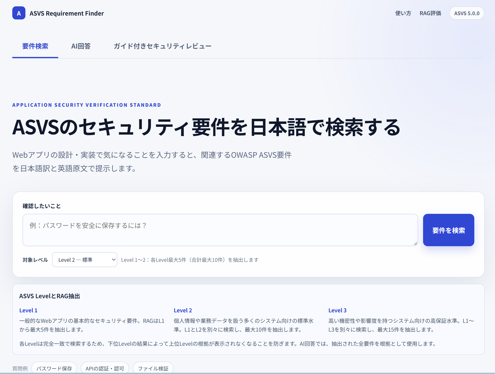

# ASVS Requirement Finder

OWASP ASVS 5.0.0 のセキュリティ要件を**日本語で検索**し、**取得した要件だけを根拠に AI が回答**し、**機能要件のセキュリティ観点をガイド付きで点検**できる Web アプリケーションです。RAG（検索拡張生成）を題材に、設計・実装・評価・クラウドデプロイまでを一通り実装した転職用ポートフォリオです。

## 🔗 ライブデモ

**https://frontend-asvs-rag-dev.thankfulgrass-fd1bce4d.japaneast.azurecontainerapps.io** — セットアップ不要・APIキー不要で、Azure 上のフル機能（ベクトル検索＋AI回答＋ガイド付きレビュー）を試せます。

> 試してみる例：「パスワードを安全に保存するには？」で要件検索 → 同じ質問で AI回答 → ガイド付きレビューで「未ログイン利用者は口コミを3件まで閲覧でき、会員は全件を閲覧できる。投稿者だけが自分の口コミを編集・削除できる」を入力。

RAG の実測品質は **https://frontend-asvs-rag-dev.thankfulgrass-fd1bce4d.japaneast.azurecontainerapps.io/evaluation**（RAG評価ページ）で確認できます。

<p align="center">
  
</p>

## 対象と課題

- **対象**：Web アプリの設計・実装でセキュリティ要件を参照したい開発者・レビュー担当。
- **課題**：OWASP ASVS は網羅的だが英語中心で量が多く、「この機能に効く要件」を素早く引き当てにくい。
- **解決**：日本語の質問から関連 ASVS 要件を検索し、取得要件だけを根拠に AI が回答。さらに機能要件を入力すると、不足しがちなセキュリティ観点を質問で補い、根拠付きで追加要件を提示する。
- **非対象**：適合性の自動判定や脆弱性診断は行いません。最終判断は担当者が行う前提の支援ツールです。

## 主な機能

1. **要件検索** — 日本語の質問から関連 ASVS 要件を検索。日本語訳（コミュニティ邦訳ドラフト）と英語原文、要件ID・章・節・スコアを提示。選択 Level までを Level ごとに検索（L1=最大5件／L2=最大10件／L3=最大15件）。
2. **AI回答** — 検索で取得した ASVS 要件**だけ**を根拠に生成し、モデルへ実際に渡した根拠要件を併記。根拠外の推測を避ける設計。
3. **ガイド付きセキュリティレビュー** — 具体化済みの機能要件を入力すると、認証・認可・データ保護などの観点で不足を質問し、ASVS 根拠付きの追加要件を整理。

## 技術的ハイライト

- **RAG**：Azure AI Search のベクトル検索（`text-embedding-3-small`, 1536次元）＋ Level 別の独立検索で、下位 Level に埋もれず各 Level の根拠を取得。回答は取得要件のみを根拠に生成。
- **Clean Architecture Lite**：domain / application / infrastructure / presentation を分離し、検索方式（CSV / Azure）や LLM を差し替え可能に。
- **評価の二面化**：自作ゴールデンセットによる**オフライン評価**（Recall@k・nDCG@k 等＋RAGAS の Faithfulness/AnswerRelevancy）と、本番トラフィックをラベル無しシグナルで見る**オンライン評価の設計**を分離。画面は保存済み結果の表示に限定し評価 API を呼ばない。
- **クラウド**：Azure Container Apps（frontend は公開、backend は環境内のみ）＋ Azure AI Search / Azure OpenAI。秘密情報は Key Vault ＋ Managed Identity で実行時解決。
- **CI/CD**：GitHub Actions。CI で lint / 型 / テストを検証し、デプロイは OIDC（federated credential、**保存シークレットなし**）で Azure へ。手動 `workflow_dispatch` のみ（コスト管理）。
- **セキュリティ/コスト配慮**：OpenAI 利用上限・Azure 予算アラート、backend 非公開、構造化ログ（要求本文・要件本文・生成回答・認証情報は記録しない）。

## 技術スタック

| 領域 | 採用技術 |
|---|---|
| フロントエンド | Node.js 24 / Next.js / React（App Router, Route Handler 中継） |
| バックエンド | Python 3.13 / FastAPI / uv |
| 検索・生成 | Azure AI Search（ベクトル検索）/ Azure OpenAI（埋め込み）/ OpenAI `gpt-4o-mini`（回答・ガイド） |
| インフラ | Azure Container Apps / Key Vault / Bicep |
| CI/CD | GitHub Actions（CI＋OIDC デプロイ） |
| 評価 | 自作ゴールデンセット＋RAGAS |

アーキテクチャ全体像は「ディレクトリ構成」を参照してください。

## 2つの試し方

| 経路 | 内容 | 必要なもの |
|---|---|---|
| **ライブデモ（推奨）** | Azure 上のフル機能（ベクトル検索＋AI回答＋ガイド付き） | 不要 |
| **ローカル（Docker）** | クローンして手元で起動。既定は CSV 検索ベースラインで**APIキー不要**で要件検索が動く | 任意で自分の OpenAI キー |

## ローカルで動かす（Docker）

Docker Desktop を起動し、プロジェクトルートで次を実行します。

```powershell
.\scripts\start-containers.ps1          # docker compose up --build を実行
# もしくは
docker compose up --build
```

- Frontend: `http://127.0.0.1:3000`
- Backend: `http://127.0.0.1:8000`（OpenAPI: `/docs`、ヘルスチェック: `/health`）

**既定は CSV 検索のため、APIキーなしで「要件検索」が動きます。**「AI回答」と「ガイド付きセキュリティレビュー」を手元で試す場合は、`.env.example` を `.env` へコピーし、各自の `OPENAI_API_KEY` と `OPENAI_CHAT_MODEL`（例: `gpt-4o-mini`）を設定してください（生成分の OpenAI 利用料は各自負担）。Azure ベクトル検索版はホスト側の Azure 設定・認証が必要で、フル機能は**ライブデモ**で確認できます。

停止とコンテナ内テスト：

```powershell
docker compose down
docker compose run --rm frontend npm test
docker compose run --rm -e ASVS_SEARCH_BACKEND=csv backend python -m unittest discover -s tests -v
```

> ホスト直接起動（Docker を使わない開発）、Azure ベクトル検索・OpenAI 回答のホスト設定、文書の Index 登録などの詳細手順は [backend の runbook](backend/scripts/README.md) と [infra の runbook](infra/README.md) を参照してください。

## 開発コマンド

```powershell
# フロントエンド（frontend/）
npm ci
npm run lint
npm test
npm run build

# バックエンド（backend/）
uv sync --locked
uv run --locked ruff format --check app scripts tests
uv run --locked ruff check app scripts tests
uv run --locked mypy app scripts tests
uv run --locked python -m unittest discover -s tests -v
```

## RAG 評価

RAG の品質は推測ではなく実測で示します。画面はライブデモの **`/evaluation`**（オフライン評価：実行日時の時系列で比較／接地が落ちた代表例／ケース別の実測値）で確認できます。オンライン評価（本番トラフィック監視）は設計のみで、現在改善中です。評価バッチは `backend/scripts/evaluate_*` で実行します。

## ディレクトリ構成

```text
.
├── frontend/        # Next.js / React（検索・AI回答・ガイド付きレビュー・評価ビュー）
├── backend/         # FastAPI（Clean Architecture Lite、RAG 検索・回答・ヒアリング）
├── infra/           # Azure リソースの Bicep と Index スキーマ
├── scripts/         # ローカル起動スクリプト
├── .github/workflows/  # CI（lint/型/テスト）と OIDC デプロイ
├── compose.yaml     # ローカル Docker 構成
├── README.md
├── AGENTS.md        # 生成AI向けの共通作業ルール
└── CLAUDE.md        # Claude Code から AGENTS.md を参照
```

## 既知の制約・スコープ

- 適合性の自動判定・脆弱性診断は行いません。提示は参照と提案であり、最終判断は担当者が行います。
- 日本語はコミュニティ邦訳ドラフトです。正式な解釈は英語原文を確認してください。
- 公開デモは学習・評価目的のため、利用量・コストを制限しています。
- ローカルの CSV 検索はベクトル検索ではないため、RAG 本来の検索品質は**ライブデモ**で確認してください。

## 免責事項

本リポジトリおよび公開デモは、作者個人の**学習・技術検証を目的としたポートフォリオ**です。現状有姿（as-is）で提供し、正確性・完全性・特定目的への適合性を含むいかなる保証も行いません。本アプリの出力（検索結果・AI回答・提案された要件など）は参照情報であり、セキュリティ適合性の保証や専門的助言ではありません。本アプリの利用または利用不能によって生じたいかなる損害についても、作者は責任を負いません。最終的な設計・セキュリティ上の判断は利用者ご自身の責任で行ってください。公開デモは予告なく停止・変更する場合があります。

## ライセンス・出典

- データは OWASP ASVS 5.0.0 に準拠します（ライセンス: CC BY-SA 4.0）。本リポジトリは OWASP による公式な承認を示すものではありません。
- OWASP ASVS 原本（公式）: https://owasp.org/www-project-application-security-verification-standard/ （ソース: https://github.com/OWASP/ASVS ）
- 本アプリの日本語訳はコミュニティ邦訳ドラフトを利用しています。

## Git 運用

Git リポジトリはルートの1つだけを使用し、`frontend/` と `backend/` では初期化しません。
